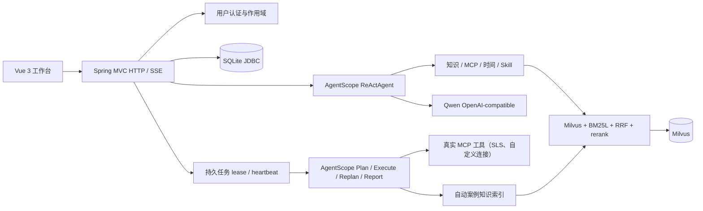

# 系统架构

## 编排与持久化

后端采用标准Maven目录。领域服务与外部Provider分开，Spring负责装配。ReActAgent承载工具循环，QwenProvider以显式OpenAIChatModel builder读取JSON配置。Embedding和rerank采用独立HTTP边界。

聊天SQLite原始消息是历史事实源，每轮取当前用户与会话的消息，按压缩边界构建AgentScope输入；Prompt和Skill目录注入说明，正文按需加载。每轮引用列表独立；ToolBase包装器保存开始、成功/失败及耗时审计。

诊断使用AgentScope模型在规划、再规划、报告阶段推理，Java领域状态机执行真实MCP工具。每个phase保存SQLite检查点，重试/重启恢复plan、next、replans、executed。用户中断不会因SSE关闭而删除任务。只读诊断拒绝上传、删除、修改等工具。

任务使用独立后台线程池与SQLite队列，领取时CAS更新，运行心跳延长租约。重启回收过期租约；失败有界重试，取消中断执行，事件持久化并支持Last-Event-ID重放。

成功诊断生成报告和report-evidence关联，随后独立持久case任务生成结构化案例并调度索引。案例id与task绑定，生成与重试保持幂等；失败诊断不生成案例。引用和反馈均按user过滤。

## 存储与检索

版本化SQL迁移位于src/main/resources/db/migration。用户、认证会话、资源、后台任务、事件、知识分片分别存储，资源键带kind/id并强制owner。所有HTTP身份来自Bearer认证。

向量实体带ownerUserId、tenantId、knowledgeBaseId和documentId。检索与删除同时过滤owner/tenant；Embedding输入为原始字符串且每批<=10条、维度1024。向量与正IDF BM25L并行召回，RRF k=60合并前20个候选，真实Qwen rerank返回最多5条，保留排名和分数。

PDFBox提取PDF正文，DocumentSplitter提供固定长度、段落和Markdown标题切分。HTTP envelope、错误码与SSE事件由共享TypeScript契约描述；OpenAPI作为Java资源提供。

## 运行边界

Compose只承载etcd、MinIO、Milvus、Attu与Alertmanager。Spring、Vue和官方SLS MCP运行在主机。Java服务使用独立业务数据库与集合，复用既有基础设施。日志只记录关联ID、状态和耗时，不记录用户正文、query、token或完整工具参数。
